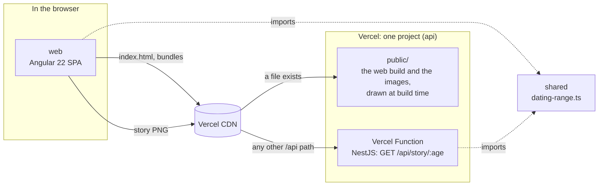

# 🏛️ Architecture

Agedate is two apps and one shared module, deployed as one Vercel project: the Angular app and the
images the NestJS app draws at build time are static files, the NestJS app itself is one function,
and both answer on the same origin. There is no database, no login and no server-side state.

This file is an index. Anything specific to a project lives in that project's own `README.md`.

## 🗺️ How it fits together

- **The rule runs in two places.** The browser computes the range once typing pauses; the build
  computes it again to draw the images. Both import [`shared`](./shared/README.md), so the numbers on
  screen and in the image cannot disagree.
- **Every story image is drawn at build time**: only ages 14 to 120 have a range, so the build
  renders all 107 and the CDN serves them as static files. The function runs only to turn away an
  invalid age.
- **In development there are two origins**: the Angular dev server (port 4400) proxies `/api/*` to
  the NestJS server (port 3400), which draws each image on request, so the browser still talks to
  one.

## 📦 Projects

| Project                        | Runs in                                |                                                      |
| :----------------------------- | :------------------------------------- | :--------------------------------------------------- |
| [`web`](./web/README.md)       | the browser                            | The single screen: age field, range, share button    |
| [`api`](./api/README.md)       | the build, a Vercel Function (Node.js) | Draws the images; answers `/api/*`                   |
| [`shared`](./shared/README.md) | both, compiled into each               | The dating-range rule; plain TypeScript, no packages |

## ⚙️ Tech stack

Versions are in each project's `package.json`, which is the only place they are correct.

### 🖥️ Front-end

- [Angular](https://angular.dev): zoneless, signals, [Signal Forms](https://angular.dev/guide/forms/signals/overview),
  `httpResource`
- [SCSS](https://sass-lang.com), with the colors as CSS custom properties

### 🗄️ Back-end

- [NestJS](https://nestjs.com) on [Express](https://expressjs.com), as ES modules
- [Satori](https://github.com/vercel/satori) and [resvg](https://github.com/thx/resvg-js) to render
  PNGs, with the [Inter](https://rsms.me/inter/) font

### 🛠️ Development tools

- [TypeScript](https://www.typescriptlang.org) and [npm](https://docs.npmjs.com)
- [ESLint](https://eslint.org) ([typescript-eslint](https://typescript-eslint.io),
  [angular-eslint](https://github.com/angular-eslint/angular-eslint)) and
  [Prettier](https://prettier.io) with
  [import sorting](https://github.com/trivago/prettier-plugin-sort-imports)
- [Husky](https://typicode.github.io/husky), [lint-staged](https://github.com/lint-staged/lint-staged),
  [Commitlint](https://commitlint.js.org) and [Commitizen](https://commitizen-tools.github.io/commitizen/)

### 🧪 Testing

[`docs/testing-strategy.md`](./docs/testing-strategy.md) has the layers, the commands and the file
naming. The tool is [Vitest](https://vitest.dev), with jsdom for the Angular tests.

## ☁️ Deployment

| What         | Runs on                                               | Triggered by                     |
| :----------- | :---------------------------------------------------- | :------------------------------- |
| `web`, `api` | [Vercel](https://vercel.com) Hobby, project `agedate` | a push to `main` (production)    |
| previews     | the same project                                      | a push to any other branch       |
| CI           | [GitHub Actions](./.github/workflows/ci.yml)          | a push to `main`, a pull request |

Vercel builds from the Root Directory `api`, configured by [`api/vercel.json`](./api/vercel.json)
alone: it installs `api/` and `web/`, builds Angular, copies it into `api/public/`, compiles NestJS
and runs it once to draw the images into the same folder. `public/` is published as static files and
`api/api/index.ts` becomes the function, which runs in Frankfurt (`fra1`). The
[API README](./api/README.md#️-how-its-wired) has the routing. CI runs lint, formatting, tests and
the same build; it does not deploy.
